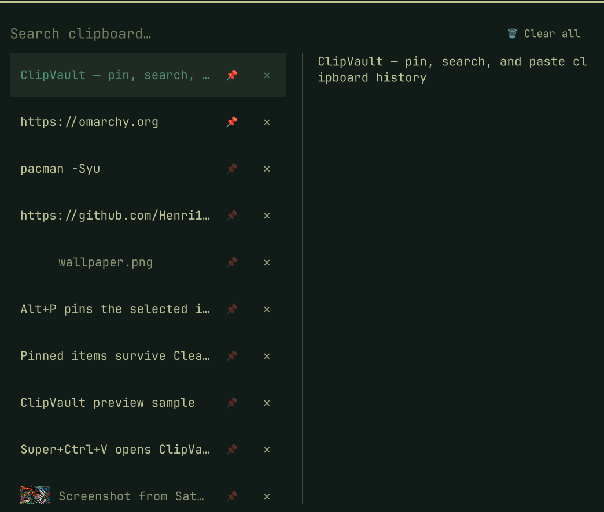

# ClipVault

Windows 11-style clipboard history for [Omarchy](https://omarchy.org/). Search, pin, preview images and files, and delete individual clips — without installing a second clipboard daemon.



> [!IMPORTANT]
> This plugin is for **Omarchy 4 (Quattro)**, where the desktop shell uses
> [Quickshell](https://quickshell.org/).

ClipVault is a drop-in replacement for the built-in `omarchy.clipboard` overlay. Enabling it automatically disables the stock plugin and keeps the default **Super+Ctrl+V** shortcut.

## What it does

- Searchable history of text, images, and copied files
- Pin items so they stay at the top and survive **Clear all**
- Unpinned history also persists across reboots (hybrid model)
- Two-pane popup: filtered list on the left, full preview on the right
- Per-row **📌** pin and **✕** delete buttons, plus **Clear all** in the header
- Shares the stock plugin's history file; pasting goes through the plugin's own `paste.sh`, which copies the exact entry and pastes it back into the window you were working in
- Reliable mouse use: clicks on a row always paste that row, scrolling is smooth, and pinning or deleting does not make the list jump
- History and screenshot files are private (`600` / `700`); history is written under `umask 077` so a save never leaves the file world-readable; pasted text is shown as plain text, not HTML
- Oversized clipboard payloads are dropped (1 MiB text, 50 MiB per image) before they are decoded, stored, or loaded into the overlay
- Stored clipboard images are capped at 64 MiB in total; evicted, deleted, and cleared image files are removed from the cache. Only plugin-created files under `clipboard-images/` are ever deleted.
- Image previews only ever load a sanitized, plugin-owned copy: PNG/JPEG clips and copied image files are checked (50 MiB, 16384 px per side, 50 MP), re-written without text/EXIF/ICC/metadata chunks into `clipboard-images/`, and malformed files are rejected. The original file path of a copied file is never handed to Qt; other formats are stored but not previewed.

## Install

Review the repository, then add and enable the plugin:

```bash
omarchy plugin add https://github.com/Henri1130/omarchy-clipvault.git --enable
```

That one command clones the plugin, validates the manifest, enables it, and disables `omarchy.clipboard`. Super+Ctrl+V then opens ClipVault.

For an unattended install from a repository you already trust:

```bash
omarchy plugin add https://github.com/Henri1130/omarchy-clipvault.git --enable --yes
```

Restart the shell if the overlay does not appear after enabling:

```bash
omarchy restart shell
```

## Use

| Action | How |
| --- | --- |
| Open / close | `Super+Ctrl+V` |
| Filter | start typing right away, or click the search box to edit the text (caret, mouse selection) |
| Clear search | `Ctrl+U`, or `Esc` |
| Paste selected | `Enter` or click the row |
| Copy selected (no paste) | `Shift+Enter` |
| Open file / image | `Alt+Enter` |
| Pin / unpin | `Alt+P` or click **📌** |
| Delete one item | `Delete` or click **✕** |
| Move in list | `↑` `↓`, `Page Up` / `Page Down`, `Home` / `End`, mouse wheel or touchpad |
| Clear unpinned items | `Shift+Delete` or **Clear all** (asks first) |
| Close | `Esc` (first press clears a non-empty search) |

Inside the search box, `Delete` removes the selected list item only when the caret is at the end of the text and nothing is selected; otherwise it deletes text. `Home` / `End` move through the list; `Shift+Home` / `Shift+End` select text in the search box.

Pinned items float to the top (the next time the popup opens or you search; while it is open a newly pinned row stays where it is so your next click still hits what you aim at). **Clear all** removes only unpinned entries.

## Update

```bash
omarchy plugin update henri.clipvault
```

## Disable

```bash
omarchy plugin disable henri.clipvault
```

This restores the built-in clipboard overlay.

## Uninstall

```bash
omarchy plugin remove henri.clipvault
```

Clipboard history in `~/.local/state/omarchy/clipboard-history.json` and image cache files in `~/.local/state/omarchy/clipboard-images/` are left in place so the stock plugin can keep using them.

## Validate from source

```bash
omarchy plugin validate .
node tests/test_clipboard_history.js
bash tests/test_save_history.sh
bash tests/test_capture_limits.sh
bash tests/test_image_store.sh
bash tests/test_image_sanitize.sh
node tests/test_mouse_paste.js
bash tests/test_paste_helper.sh
```

## Dependencies

Provided by Omarchy; nothing extra to install:

- `wl-clipboard` (`wl-paste` / `wl-copy`)
- `wtype` and `hyprctl` (paste and refocus)
- `jq`
- `perl` (core modules only; image sanitizing)
- `setpriv` (util-linux)
- Quickshell / Qt image support

## Changelog

### 1.4.4
- Fix for Omarchy 4.5: deferred search-focus calls are guarded, so reloading or restarting the shell no longer logs a `TypeError` from the clipboard overlay.

### 1.4.3
- Security: image previews never load the original file of a copied image or any non-plugin path. PNG/JPEG clips and copied PNG/JPEG files are validated (50 MiB, 16384 px per side, 50 MP, CRC/structure) and re-written by `sanitize-image.pl` into a metadata-free managed copy; only that copy is shown. Malformed images are dropped; other image formats and entries from older versions are kept but not previewed. The overlay additionally refuses any preview path that is not exactly `<state>/omarchy/clipboard-images/<sha256>.png|jpg`. A single image up to 50 MiB fits the 64 MiB store; the next large image evicts the oldest stored file, never the one just copied.

### 1.4.2
- The header search is now a real text box: click it for a caret, select text with the mouse, edit anywhere in the filter. Typing right after opening still filters, and arrow/Page/Home/End/Enter/Esc/Delete/Alt+P keep driving the list.

### 1.4.1
- Fix: the history file watcher re-applied file permissions on every reload, and each permission change triggered another reload — hundreds per second. While the popup was open this rebuilt the list constantly, snapping the selection/scroll back to the top and making hover, clicks and scrolling erratic (also wasted CPU while closed). Permissions are now set once at startup and identical reloads are ignored.
- Scrolling is back to native Qt wheel/touchpad scrolling (smooth, kinetic); row clicks stay protected with `preventStealing`.

### 1.4.0
- Fix: clicking a row sometimes did nothing because the list could take over the click as a drag; row clicks now use `preventStealing`. (1.4.0 also replaced wheel scrolling with row jumps; 1.4.1 restored native scrolling.)
- Fix: a mouse paste could land in the window under the pointer instead of the one you were typing in. ClipVault remembers the focused window when it opens and refocuses it before pasting.
- Fix: paste now pipes the exact entry from memory to `wl-copy` (new `paste.sh`) instead of re-reading `clipboard-history.json` by index, so a paste right after pin/delete/copy can no longer pick the wrong or no entry.
- Pin and delete update the list in place, so the rows under the pointer no longer jump.
- Fix: popup rendered all black after the Qt 6.12 / Quickshell 0.3.2 update (QtQuick's new `Color` type shadowed the theme singleton); colors now use `Commons.Color` like the stock plugins.

### 1.3.3
- Stored clipboard images are capped at 64 MiB in total; evicted, deleted and cleared images are removed from the cache (`prune-images.sh`).

## License

MIT. See [LICENSE](LICENSE).
